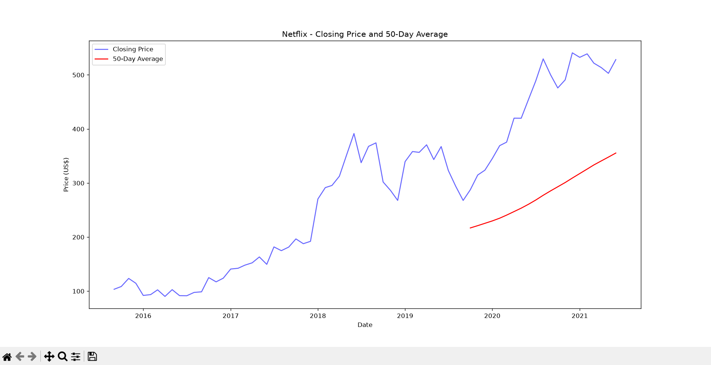
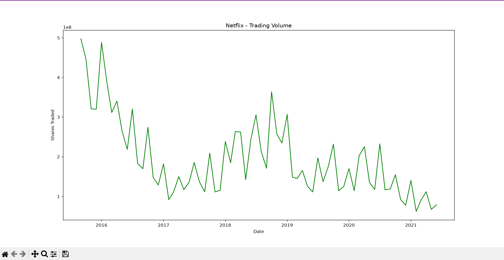
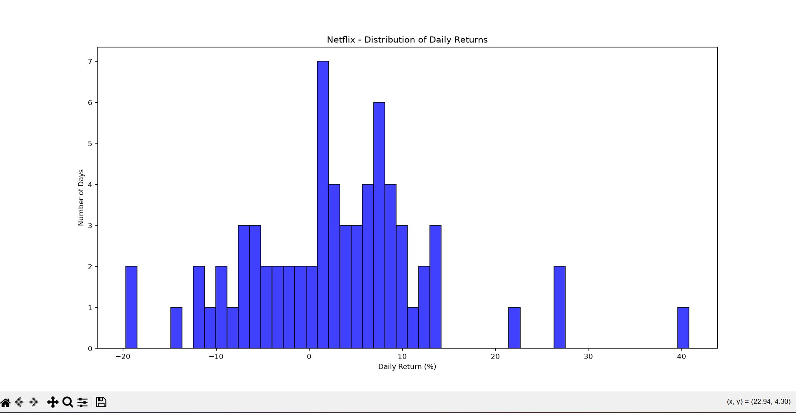

# Netflix Stock Data: Web Scraping and Analysis

Scraping Netflix's share price history from a web page, cleaning it, and studying its price trend, trading volume and daily returns in Python.

## About

- **Goal:** Collect Netflix stock data from a web page and understand how the price behaved over time.
- **Data:** A Netflix price table (date, open, high, low, close, volume) from an IBM Data Analyst Professional Certificate lab page.
- **Tools:** Python, pandas, requests, BeautifulSoup, Matplotlib, Seaborn

## What I Did

1. Scraped the price table from the web page using `requests` and `BeautifulSoup`.
2. Cleaned the data: converted dates and numbers from text, removed commas and dropped rows that could not be read.
3. Added two new columns: daily return (%) and a 50-day average of the closing price.
4. Calculated summary numbers: highest and lowest close, average daily return and volatility.
5. Created three charts to show the trends.

## Charts

**1. Closing Price and 50-Day Average** 



**2. Trading Volume** 



**3. Distribution of Daily Returns** 



## Results

> Fill in from the summary printed by the script.

| Measure | Value |
|---|---|
| Period | 2015-09-01 to 2021-06-01 |
| Highest close | 540.73 on 2020-12-01 |
| Lowest close | 90.03 on 2016-04-01 |
| Average daily return | 2.883 % |
| Volatility (std. dev. of daily return) | 10.234 % |

## Limitations

- The data covers a limited period, so the results do not describe Netflix's whole history.
- The scraper depends on the web page's layout. If the page changes, the code may need updating.
- Past price movements do not predict future prices.

## How to Run

```bash
pip install -r requirements.txt
python netflix_stock_scraping_analysis.py
```

Charts are saved in the `images/` folder.

## Credits

Based on a lab from the **IBM Data Analyst Professional Certificate** on Coursera. I extended it with data cleaning, daily returns, a 50-day average, summary numbers and charts.
